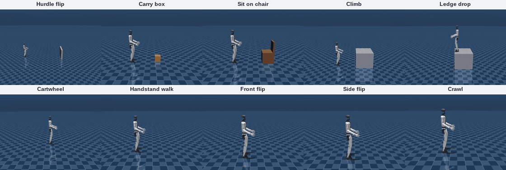

<h1 align="center">MimicAgent</h1>
<h3 align="center">Language-Driven Whole-Body Motion Generation</h3>

<div align="center">

**From a skill prompt to a robot reference trajectory.**

[Website](https://luckykantnayak.github.io/mimic-agent/) ·
[arXiv Paper](https://arxiv.org/abs/2609.24145) ·
[Architecture](docs/ARCHITECTURE.md)

[](https://mujoco.readthedocs.io/)
[](https://www.python.org/)
[](https://www.anthropic.com/claude)
[](https://github.com/langchain-ai/langgraph)
[](https://ubuntu.com/)
[](LICENSE)

</div>

<p align="center">
  
  <br />
  <sub>MimicAgent-generated Unitree G1 reference motions · Kinematic previews</sub>
</p>

---

[Overview](#overview) · [Installation](#installation) · [Generate](#generate-a-skill) · [Replay](#replay) · [Checks](#optional-ui-and-checks)

## Overview

This repository contains the humanoid and Unitree G1 implementation of MimicAgent.
Claude turns a natural-language request into motion-generator code, then checks
and repairs the resulting trajectory in a kinematic MuJoCo simulator.

**Prompt → Goal & plan → Code → Simulate & evaluate → Repair → Export**

The robot model and scene provide the geometry; the prompt defines the skill.
Outputs include the generated code, evaluation reports, preview GIFs, and
MimicKit-compatible reference trajectories.

## Installation

**Requirements:** Linux, Python 3.11, and an Anthropic API key for generation.
Run the commands below from the repository root.

### 1. Create an environment

Keep the project dependencies in a dedicated Python environment.

```bash
python -m venv .venv
source .venv/bin/activate
```

### 2. Install dependencies

Install the agent, MuJoCo simulator, and preview-rendering packages.

```bash
python -m pip install -r requirements.txt
python -m pip install imageio pillow imageio-ffmpeg
```

### 3. Configure Claude

```bash
export ANTHROPIC_API_KEY="your-api-key"
```

Choose the model and generation budget in `agent/cfg/config.yaml`.
Replaying motions and running offline checks do not require an API key.

## Generate a skill

```bash
(cd agent && python run.py \
  --skill "The humanoid walks forward, turns left, and stops." \
  --name SKILL_WALK_TURN)
```

For G1, select the robot per run:

```bash
(cd agent && ROBOT_NAME=g1 python run.py \
  --skill "The G1 robot crawls forward on its hands and knees, then stands up." \
  --name SKILL_CRAWL)
```

Results are saved under `skill_output/<robot>/<skill>/`: generated code, motion
plan, evaluation report, trajectories, and a preview GIF when rendering succeeds.
Check `metadata.json` for the outcome; `best_effort` and `unverified` are not passes.

## Replay

```bash
# Built-in interface example; no API key required
python simulator/run.py --robot humanoid --mode example

# Replay a generated skill with its saved scene and plan
python simulator/run.py --robot humanoid --mode SKILL_WALK_TURN --record True
```

Use `--robot g1 --mode SKILL_CRAWL` for the G1 example above. The viewer needs a
display; add `--headless True` to record without opening a window.

## Optional UI and checks

```bash
(cd agent && streamlit run app.py)
python -m unittest discover -s agent/tests -v
python agent/score_skills.py --json scores.json
```

## Notes

- These are kinematic references. Passing checks or producing a GIF does not prove
  that a controller can track the motion.
- Robot specifications live in `robots/`; models and scenes live in `assets/`.
- Generated outputs, hand-authored libraries, training runs, and local assistant
  files are excluded from Git.
- See [Architecture](docs/ARCHITECTURE.md), [Adding a Robot](docs/ADDING_A_ROBOT.md),
  and [License](LICENSE) for further details.
