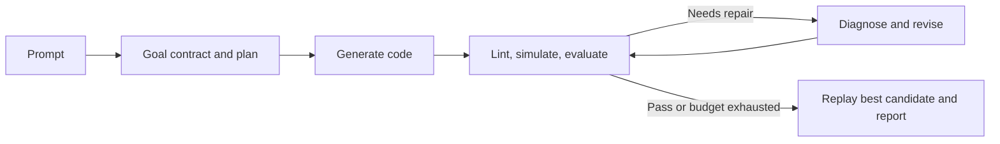

# Architecture

[README](../README.md) · [Adding a Robot](ADDING_A_ROBOT.md)

MimicAgent generates kinematic reference trajectories from natural-language prompts.
The CLI and Streamlit UI use the same pipeline in [`agent/pipeline.py`](../agent/pipeline.py).

## Components

| Location | Purpose |
| --- | --- |
| `agent/` | Goal definition, planning, code generation, evaluation, and repair. |
| `simulator/` | Robot/scene composition, IK, soft contact fitting, recording, and previews. |
| `robots/<name>/` | Shared robot specification, interface example, and generated model summaries. |
| `assets/` | Robot models and meshes, plus scenes containing only the environment. |
| `skill_output/<robot>/<skill>/` | Generated code, trajectories, reports, and previews; ignored by Git. |

`robots/<name>/robot.yaml` supplies morphology to both the agent and simulator.
The simulator combines the selected robot with a scene at load time.

## Pipeline

The goal contract is compiled and reviewed before planning. Repairs and replanning
cannot weaken it. Repeated failures can trigger one replan; the iteration budget
is configured in `agent/cfg/config.yaml`.

## Motion interface

Skills subclass [`BaseMotionGenerator`](../simulator/motion/base.py):

- **Base and limbs:** author the base pose and world- or body-frame IK targets.
  Joint overrides act as soft posture preferences on IK-owned chains and direct
  angles on free chains. Quaternions use `[w, x, y, z]`.
- **Home pose:** the model's named `home` keyframe supplies the shared neutral pose.
  Skills access it through `self.home_pose` and `self.home_joint_pose()`.
- **Contacts:** `contacts(phase)` declares support using end-effectors or additional
  `contact_bodies`. Hands, knees, and other registered bodies are supported, even
  without an IK target. `compute_contact_constraints(phase)` can specify a surface,
  body-local point, and contact mode. An empty contact list declares flight.
- **Objects:** `compute_object_poses(phase)` describes object motion;
  `attachments(phase)` declares which end-effectors hold an object.

The final soft contact fit adjusts the base and joints with finite contact,
posture, and continuity penalties. Achieved gaps and drift are recorded for
validation. Declared flight follows gravity; dynamics diagnostics are otherwise
advisory by default. A preview does not establish controller trackability.

## Acceptance and outputs

Evaluation checks achieved geometry and motion against the fixed goal, generic
checks, and supplementary plan criteria. Finalization replays the selected code
with its own plan before reporting an outcome.

- `complete`: all mandatory criteria pass on the final replay.
- `best_effort` or `unverified`: validation is incomplete; attempts are retained.
- Inspect `<skill>_goal.json`, `<skill>_plan.json`, `<skill>_report.json`, and
  `metadata.json` alongside the generated Python, trajectory PKLs, and preview.

For setup, generation, replay, and test commands, see the [README](../README.md).
